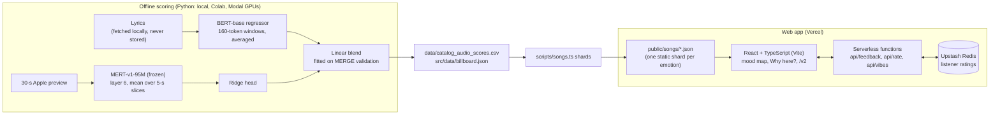

# senti

[](https://github.com/jason-d-garcia/senti/actions/workflows/ci.yml)

**Live: [playsenti.com](https://playsenti.com)** · **Report: [*Lyrics for Meaning, Audio for Energy*](public/senti-report.pdf) (7 pages)**

senti is a mood-based music discovery app: drag a point across a valence (feels bad → feels good) by arousal
(calm → wired) map and get songs with that feeling, with 30-second previews and Spotify links, no login. The map
places 5,411 Billboard year-end Hot 100 songs (1960–2025) using a fine-tuned **BERT** lyrics regressor blended with
a ridge head on frozen **MERT** audio embeddings of each song's preview. On the held-out MERGE benchmark, adding
audio raises arousal correlation from 0.61 to 0.77; in a 15-rater listening study it raises arousal agreement with
listeners from 0.57 to 0.85. The front end is React + TypeScript + Vite on Vercel, with listener ratings stored in
Upstash Redis. *"senti" is Italian for "you feel" / "listen" (from* sentire*); the project was formerly called Moodify.*

## Results

All numbers are Pearson r between predicted and reference valence/arousal. Bracketed ranges are 95% paired-bootstrap
intervals over songs. Full tables: [`data/README.md`](data/README.md) and the [report](public/senti-report.pdf).

**1. MERGE benchmark** (held-out test split, seed-42 80/10/10, labels from AllMusic tags via word norms, not listeners)

| Model | Test songs | Valence r | Arousal r |
|---|---|---|---|
| Original 4-class classifier, mapped to the circle | 256 | 0.462 | 0.106 |
| BERT-base lyrics regressor (live) | 256 | 0.724 | 0.605 |
| BERT-base lyrics regressor (live) | 206 with audio | 0.716 | 0.611 |
| Audio only: ridge on frozen MERT-v1-95M layer 6 | 206 with audio | 0.683 | 0.750 |
| **Lyrics + audio blend (live)** | 206 with audio | **0.770** | **0.765** |
| Gain of blend over lyrics only | 206 with audio | +0.054 [+0.017, +0.095] | +0.154 [+0.081, +0.235] |

**2. Listening study** (own study: 15 raters, 100 songs, 438 first-listen placements; reference = median listener
placement)

| Measure | Valence | Arousal |
|---|---|---|
| Lyrics only → lyrics + audio, r with listeners | 0.63 → 0.65 (within noise) | **0.57 → 0.85**, gain +0.28 [+0.17, +0.39] |
| Rater test-retest reliability (hidden repeats) | 0.73 | 0.70 |

The blended model sits closer to the leave-one-out crowd consensus than 12 of the 15 individual raters (2-D
distance 0.38 vs 0.50 for the average rater).

**Model choices backed by the numbers**

- *Encoders:* DeBERTa-v3-base and RoBERTa-base, trained the same way, were not reliably better than BERT-base, and
  DeBERTa was significantly worse on arousal (Δr −0.082 [−0.160, −0.007]), so BERT-base stays.
- *Audio fine-tuning:* fine-tuning MERT end to end (3 seeds on Modal) beat the frozen head on MERGE (valence +0.059,
  arousal +0.042, both significant) but gave no gain with listeners (blend valence 0.615 vs 0.648, arousal 0.839 vs
  0.845), so the simpler frozen head stays live.
- *Whole-song reading:* averaging overlapping 160-token windows instead of reading only the first lifted test r
  from 0.70 to 0.72 (valence) and 0.56 to 0.60 (arousal).

## Architecture



- **Lyrics model.** `bert-base-cased` pooled output → dropout (0.3) → linear → tanh, predicting valence and arousal in
  [−1, 1]. Trained with MSE, AdamW 2e-5, 10% warm-up, 5 epochs, batch 8, on 2,044 MERGE songs. At inference a lyric is
  cut into 160-token windows (stride 120, at most 8) and the predictions are averaged.
- **Audio model.** Frozen MERT-v1-95M, layer 6, averaged over 5-second slices of the 30-second preview; a ridge
  regression maps the embedding to valence and arousal.
- **Fusion.** `valence = 0.65 × lyrics + 0.61 × audio`, `arousal = 0.14 × lyrics + 1.02 × audio` (plus small biases),
  fitted on MERGE validation songs. Audio carries energy; lyrics carry most of the meaning. 2,568 catalogue songs have
  an audio score; the rest are placed by lyrics alone.
- **The map.** Russell's circumplex, cut into the 16 emotion words of Feldman Barrett & Russell (1998) as reproduced
  in Posner, Russell & Peterson (2005): four per quadrant, as equal 22.5° slices (a simplification of the schematic
  published figure). Points within 0.2 of the centre are *Mixed*.

  | Quadrant | Sections, counter-clockwise |
  |---|---|
  | Feels good + wired | Happy, Elated, Excited, Alert |
  | Feels bad + wired | Tense, Nervous, Stressed, Upset |
  | Feels bad + calm | Sad, Depressed, Lethargic, Fatigued |
  | Feels good + calm | Calm, Relaxed, Serene, Contented |

- **Why here?** Each song card shows where the lyrics alone and the audio alone would put the song, whether they
  agreed, and the nearest songs by each source.
- **Listener ratings.** Visitors can confirm a song's spot or drag it elsewhere; about a third of prompts are blind
  (placed before the model's spot is shown). A rated song is shown between the model's prediction and the listeners'
  median, with the model counting as 3 listeners. One rating per song per browser, 20 per minute per IP.
- **senti 2 (trial, `/v2`).** Pick where you are and where you want to end up; a dynamic-programming pass lines up six
  previewed songs that step from one feeling to the other.

## Repository layout

```
.
├── src/                  React + TypeScript app (mood mapping, search, explain, ratings) and its Vitest tests
│   ├── minimal/          default view;  App.tsx is the classic view (?classic)
│   ├── rate/  v2/        listening-study page and the senti 2 trial
│   └── data/             MERGE test-song catalogue and Billboard whole-song scores (JSON)
├── api/                  Vercel serverless functions (ratings, study, vibe tags) backed by Upstash Redis
├── public/               static assets, report PDF, and songs/<emotion>.json map shards
├── scripts/              training, scoring, data-building and asset scripts (Python + TypeScript)
├── notebooks/            Colab notebooks: encoder comparison, audio fusion, catalogue audio scoring
├── data/                 score CSVs, encoder comparison, fine-tuning results (see data/README.md)
├── paper/                LaTeX source, references and figure script for the report
├── tests/                Python unit tests (study statistics, fusion blend)
├── index.html  about.html  rate/  v2/   page entry points (Vite multi-page build)
└── requirements/         pinned Python deps: research.txt (scripts) and dev.txt (lint + tests, CI)
```

## Reproduce

### Web app, tests and lint (no GPU, no secrets)

Node 22 and Python 3.11 are what CI uses.

```bash
npm ci
npm run dev          # local dev server
npm test             # Vitest: mood regions, blend/explain, search, ratings, trips
npm run typecheck    # tsc --noEmit
npm run build        # static multi-page site in dist/

pip install -r requirements/dev.txt
ruff check .         # Python lint
pytest -q tests      # Python unit tests
```

Without Upstash configured, ratings stay in each visitor's browser. To share them, add Upstash for Redis to the Vercel
project (Storage > Upstash), which sets `KV_REST_API_URL` and `KV_REST_API_TOKEN`. Add `?embed` to the URL to hide the
header and method notes.

### Rebuild the map from the committed scores

```bash
npm run shards       # = npx vite-node scripts/songs.ts shards
git diff --stat public/songs    # empty: the shards are reproduced byte for byte (checked in CI)
```

`scripts/songs.ts` refits the fusion weights from `data/catalog_audio_scores.csv`, fails if any row does not follow
them, and writes `public/songs/<emotion>.json`. Its `prefetch` and `audio-csv` subcommands look up previews (iTunes
Search API, cached in `data/previews.jsonl`) and export `data/catalog_previews.csv` for audio scoring.

### Report figures

```bash
pip install -r requirements/research.txt
cd paper && python make_figures.py --repo ..    # writes figures/*.pdf from the committed CSVs
```

Study figures are recomputed only when you pass `--ratings senti_ratings.csv`; the study ratings are not in the repo.

### Training and evaluation (needs data that is not redistributed, and a GPU)

Lyrics are copyrighted and are never committed, so training starts from your own `va_lyrics.csv`: MERGE's
valence/arousal labels joined with lyrics you fetch yourself (columns `title, artist, lyrics, valence, arousal,
quadrant`). The join itself is not scripted in this repo.

```bash
# Lyrics regressor. Run from a checkout of github.com/jason-d-garcia/bert-lyrics-sentiment-analysis,
# because train_va.py imports its dataset.py and model.py (for the 4-class baseline).
python /path/to/senti/scripts/train_va.py --data va_lyrics.csv --cls_checkpoint best_model_state.bin
#   -> va_model_state.bin, va_report.json, va_test_predictions.csv (seed 42, 5 epochs, lr 2e-5, batch 8, 160 tokens)
```

| Step | How |
|---|---|
| Encoder comparison (DeBERTa-v3, RoBERTa) | [`notebooks/colab_va_compare.ipynb`](notebooks/colab_va_compare.ipynb) on a Colab GPU |
| Audio head + fusion weights on MERGE | [`notebooks/colab_audio_fusion.ipynb`](notebooks/colab_audio_fusion.ipynb) (writes `audio_head.joblib`) |
| Score the catalogue with audio | `modal run scripts/modal_catalog.py --previews data/catalog_previews.csv --head audio_head.joblib --out data/catalog_audio_scores.csv` (or [`notebooks/colab_audio_catalog.ipynb`](notebooks/colab_audio_catalog.ipynb)) |
| Fine-tune MERT end to end | `modal run scripts/modal_finetune.py --lyrics va_lyrics.csv --bert va_model_state.bin --head audio_head.joblib --previews data/catalog_previews.csv` (`--trial` for a cheap check) |
| Compare with the listening study | `python scripts/compare_study.py --ratings senti_ratings.csv` (needs the study export) |

The Modal scripts need `pip install modal` and a Modal account; they pin their own GPU images
(torch 2.4.1, transformers 4.45.2, scikit-learn 1.6.1).

## Limitations

- **Small convenience sample.** The listening study has 15 raters (recruited from personal networks) and 100 songs,
  so valence differences of a few hundredths are within noise and the raters are not representative of all
  listeners. The ratings are not in this repo.
- **Noisy benchmark labels.** MERGE's valence/arousal come from AllMusic mood tags mapped through word norms, not from
  listeners rating each song. Audio-only valence is r 0.68 on MERGE but only 0.35 against the study's listeners.
- **Preview, not song.** Audio is scored from a 30-second preview; listeners in the study heard a median of 9 seconds.
- **Partial audio coverage.** 2,568 of 5,411 catalogue songs have an audio score; the rest are lyrics-only.
- **Billboard positions are predictions.** There are no reference labels for the catalogue itself; individual songs
  can be misplaced, and averages are more reliable than single songs.
- **Equal slices.** The 16 sections use equal 22.5° slices, a simplification of the circumplex figure.
- **Reproducibility boundary.** Training needs lyrics and MERGE audio that cannot be redistributed, plus a GPU; CI
  checks the code paths and the committed numbers, not retraining.

## Credits and license

Built by Jason Garcia.

- **MERGE** labels: P. L. Louro, H. Redinho, R. Santos, R. Malheiro, R. Panda, R. P. Paiva (2024), *MERGE: A Bimodal
  Dataset for Static Music Emotion Recognition*, [Zenodo 13939205](https://zenodo.org/records/13939205),
  [CC BY-NC 4.0](https://creativecommons.org/licenses/by-nc/4.0/). MERGE-derived files in `data/` are redistributed
  under that licence for non-commercial use; senti is non-commercial.
- **Models:** [`bert-base-cased`](https://huggingface.co/bert-base-cased) and
  [`m-a-p/MERT-v1-95M`](https://huggingface.co/m-a-p/MERT-v1-95M). The earlier 4-class model is
  [bert-lyrics-sentiment-analysis](https://github.com/jason-d-garcia/bert-lyrics-sentiment-analysis).
- **Catalogue:** Billboard year-end Hot 100 lists from Wikipedia; lyrics read locally from Genius and never stored;
  previews and artwork from the iTunes Search API; Spotify links use public search URLs.
- **Affect model:** Russell (1980); Feldman Barrett & Russell (1998); Posner, Russell & Peterson (2005).

**License:** no license file has been added yet, so the code is all rights reserved by default. The data licences
above apply to the data regardless.

Future ideas: [ROADMAP.md](ROADMAP.md).
